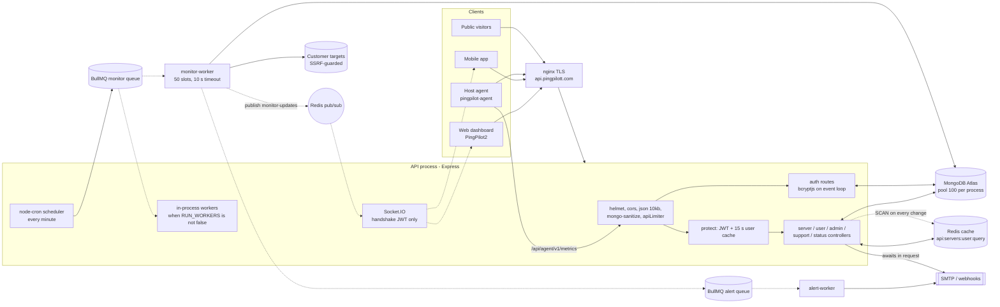

# API backend audit: Ping Pilott   2026-11-15

Scope:      `Ping-Pilott-Backend` (Express 4, Mongoose/MongoDB, BullMQ/Redis, Socket.IO, node-cron). Web (`PingPilot2`) and mobile were read only to see which endpoints they call.
Mode:       Static reading plus dynamic probes against an isolated copy of the API (see "Dynamic verification").
Baseline:   `docs/audits/server-monitoring-2026-10-24.md` already covers the monitoring pipeline (scheduler, workers, alerting, incidents, SSRF guard, retention). This audit does not repeat it. It covers what that audit listed as not covered (auth, users, admin, support, status pages, sockets, deploy files) and adds the request-flow map, capacity math and the new lenses (resilience, auth lifecycle, dependencies, data lifecycle).
Not run:    `npm audit` (it sends the dependency list to the npm registry; versions were read from `node_modules` instead). The workers and the monitoring pipeline were not run.

## Summary

The basics are done well. Every by-id route checked ownership, mass assignment was blocked, the SSRF guard stopped 17 of 18 hostile address forms, secrets are stripped from user JSON, and the public status page exposes almost nothing. The weak spots are about **abuse and scale**, not missing authentication:

1. A free user can exceed the plan's server limit by sending requests in parallel (12 of 12 creates succeeded on a limit of 5).
2. Password hashing runs on the Node event loop, so a few concurrent logins or sign-ups stall the whole process. Sign-ups and successful logins are not rate limited, and the API process also runs the monitoring workers on single-process hosts.
3. Sessions cannot be revoked. There is no logout, refresh tokens are not rotated, and sockets accept tokens that REST already refuses.

Fix first: H1, H2, M1, M2. Then the cheap hardening items M3, M4, M5, M8.

| Severity | Count |
|---|---|
| Critical | 0 (carry-over F3 from 2026-10-24 is still an open owner action) |
| High | 2 |
| Medium | 12 |
| Low | 8 |

## Endpoint inventory (from `index.js:204-223` and `routes/*.js`)

Global chain: cors -> helmet -> compression -> json (10 kb) -> urlencoded -> mongo-sanitize -> timing log -> routes -> 404 -> error handler. `apiLimiter` (300 per minute per IP) covers `/api/*` except `/api/agent`.

| Method | Path | Auth | Extra limits / validation | Touches |
|---|---|---|---|---|
| GET | `/health`, `/health/monitoring` | none | none | Mongo ping, Redis ping, queue state |
| GET | `/install.sh` | none | `installLimiter` 60/min | file read |
| POST | `/api/agent/v1/metrics` | agent token | per-token 12/min, 30 refused/min per IP | Server, User, HostMetric |
| POST | `/api/auth/register` | none | `authLimiter` (failures only), express-validator | User, bcrypt, SMTP (if verification on) |
| POST | `/api/auth/login` | none | `authLimiter` 10 failures per IP+email per 15 min | User, bcrypt |
| GET | `/api/auth/verify-email` | token in query | `tokenLimiter` 30/15 min | User |
| POST | `/api/auth/resend-verification`, `forgot-password` | none | `emailLimiter` 5/h per IP+email | User, SMTP |
| POST | `/api/auth/reset-password`, `refresh-token` | token in body | `tokenLimiter` | User |
| GET | `/api/auth/me` | JWT | none | cached user |
| GET/POST/PATCH/DELETE | `/api/servers`, `/:id` | JWT + owner check | express-validator + Zod, plan limits, SSRF guard | Server, Redis cache, ServerCheck |
| POST | `/api/servers/:id/check`, `/batch-check` | JWT + owner | 30 s per-server throttle (read then act) | outbound probe, ServerCheck, Redis |
| GET | `/api/servers/:id/history`, `/metrics` | JWT + owner | period enum | ServerCheck, HostMetric |
| POST/DELETE | `/api/servers/:id/agent`, `/agent/rotate` | JWT + owner | none | Server (token) |
| GET | `/api/incidents`, `/api/alerts`, `POST /api/alerts/read-all`, `PATCH /api/alerts/:id/read` | JWT | validated, filtered by user | Incident, AlertEvent |
| GET/POST/PATCH/DELETE | `/api/status-pages` | JWT + owner | Zod, plan allowance | StatusPage |
| GET | `/api/public/status/:slug` | none | 600/min per IP+slug, 60 s Redis cache | StatusPage, Server, ServerCheck aggregate |
| GET | `/api/app/version` | none | 5 min cache header | none |
| PATCH/DELETE | `/api/users/me`, `/change-password` | JWT | delete asks for password | User, purge |
| GET/PATCH/DELETE | `/api/users`, `/api/users/:id` | admin | search capped at 100 chars, limit 200 | User |
| POST/GET/PATCH | `/api/admin/create`, `/list`, `/revoke/:id` | admin | none beyond `authorize` | User |
| POST | `/api/admin/initial-setup` | **none** (setup token in body) | **no limiter of its own** | User |
| GET | `/api/admin/analytics/*` | admin | 5 min Redis cache | aggregations |
| POST/GET/PATCH | `/api/support/tickets...`, `/api/support/admin/...` | JWT / admin | none beyond `apiLimiter` | SupportTicket, SMTP |
| WS | Socket.IO `server:update`, `alert:new`, `alert:host` | JWT at handshake | rooms `user:<id>`, `server:<id>`, `admins` | Redis pub/sub |

## Request-flow map

Trust boundaries: public (health, install.sh, public status, app version, auth, initial-setup) -> authenticated user (`protect` + owner checks) -> admin (`authorize('admin')`) -> agent (per-server token) -> internal (Redis, Mongo, workers).

### Critical flow traces

**1. Sign-in and every later request**
1. `POST /api/auth/login` -> `authLimiter` counts only failures (`middleware/rateLimiter.js:44-50`, `skipSuccessfulRequests`).
2. `User.findOne` + `bcrypt.compare` (`controllers/authController.js:106-117`). Unknown email returns after one query with no hash (`:109-114`). Surprise: 4 ms against 76 ms measured.
3. Access token 1 day, refresh token 7 days, both stateless (`authController.js:10-21`). No server-side record.
4. Each request: `protect` verifies the JWT, loads the user from a 15 s in-process cache, checks `passwordChangedAt` (`middleware/auth.js:12-61`).
5. Socket handshake verifies the JWT and loads the user but never checks `passwordChangedAt` (`config/socket.js:36-51`). Surprise: REST and socket disagree about the same token.

**2. Create a monitor**
1. `POST /api/servers` -> express-validator trims fields, then Zod parses (`routes/serverRoutes.js:25-45`, `utils/validations.js`).
2. Plan frequency rules, `normalizeUrl`, `assertPublicHost` (DNS plus private-range checks) (`serverController.js:329-400`).
3. Duplicate-URL `findOne`, then limit `countDocuments`, then `Server.create` (`serverController.js:394-463`). Surprise: three separate steps, no unique index, no transaction.
4. `invalidateServerCache` walks the whole Redis keyspace with SCAN (`utils/cacheManager.js:23-49`).
5. Scheduler later books `nextCheckAt` with one `bulkWrite` and queues BullMQ jobs (`tasks/checkServers.js:30,52`).

**3. A check result reaches the user** (summary only; detail in the 2026-10-24 audit)
Worker checks target -> `applyCheckResult` compare-and-set -> incident -> alert queue -> email/webhook -> Redis publish -> API process `redisSubscriber` -> `io.to(user room)`. The socket room is joined once at connect and never revisited (`config/socket.js:57-58`).

**4. Support ticket**
`POST /api/support/tickets` -> `SupportTicket.create` -> `await sendSupportNotificationEmail` inside the request (`controllers/supportController.js:21-36`). Mail timeouts are 10 s connect, 10 s greeting, 30 s socket (`services/emailService.js:56-59`), so a slow mail server holds the HTTP request up to about 50 s. Surprise: no per-user ticket limit, so every ticket triggers an admin email.

**5. Public status page**
`GET /api/public/status/:slug` -> slug format check -> Redis cache (60 s) -> on miss: `StatusPage`, `Server`, `User`, a `ServerCheck` aggregate over 90 days and `Incident` in parallel (`controllers/statusPageHandlers.js:493-550`). Solid: cache, per-slug limit, nothing about addresses or errors is returned.

## Findings

### H1. Plan server limit and duplicate-URL check can be beaten with parallel requests   [High | S | Confirmed]

Where:     `controllers/serverController.js:394-463` (duplicate `findOne`, limit `countDocuments`, `Server.create`), `models/Server.js:358-370` (no unique index on `uploadedBy` + `url`)
Lens:      Correctness; abuse
Scenario:  A free user (limit 5) sends 12 `POST /api/servers` calls at once with different URLs. Each one counts 0 servers, passes, and creates.
Evidence (dynamic): 12 concurrent creates on a fresh free account -> all 12 returned 201 and 12 rows exist (limit 5). 5 concurrent creates of the same URL -> 5 rows. The check-then-write steps are visible in the code at the cited lines.
Impact:    Paid limits are not enforced against anyone who scripts the call. Each extra monitor is scheduled and probed, so it is also free resource use. The 2026-10-24 audit listed this as "left open" under F14; it is confirmed exploitable.
Fix:       Make the limit atomic: reserve a slot with `User.findOneAndUpdate({ _id, serverCount: { $lt: max } }, { $inc: { serverCount: 1 } })`, create the server, and decrement on failure or delete (plus a nightly reconcile). Add a unique index on `{ uploadedBy: 1, url: 1 }` after checking existing data for duplicates.
Test:      12 concurrent creates against a limit of 5 -> exactly 5 succeed.
Risk:      Needs a one-off count and de-dup of existing servers before the index; the counter needs a backfill.

### H2. Password hashing blocks the event loop, and sign-ups and successful logins are not throttled   [High | M | Confirmed]

Where:     `models/User.js:163-177` (bcryptjs, cost 10), `middleware/rateLimiter.js:44-50` (`skipSuccessfulRequests`), `index.js:71-91` (workers run inside the API process unless `RUN_WORKERS=false`), `index.js:108,211` (limits are per IP and trust one proxy hop)
Lens:      Scale; availability; security
Scenario:  An attacker signs up accounts, or logs into accounts they own, in a loop from a few addresses. Every call costs about 80 ms of CPU on the single event loop, and nothing in the auth limiter counts it.
Evidence (dynamic, measured on this laptop; production CPU will be slower):
- Login: 76 to 78 ms each, sequential. 8 concurrent logins took 615 ms in total, and `/health` answered only 2 pings during that time, the slowest after 580 ms. The whole process stopped serving.
- 20 sign-ups from one address in a row: 20 created, 0 throttled, 85 ms each.
- `bcryptjs` 2.4.3 is the pure JavaScript implementation (`package.json`).
Impact:    About 13 hashes per second is the ceiling per core. One address at the allowed 300 requests per minute costs about 39% of a core; three addresses saturate it. On single-process hosts (the code comments name Render's free tier) the monitor and alert workers share that loop, so an attack also delays checks and alerts.
Fix:       Use a native hash that runs off the loop (`bcrypt` or `argon2`, with `UV_THREADPOOL_SIZE` already set to 16 in the Dockerfile). Add a limiter on registration (for example 10 per hour per address) and on successful logins per address. Run the workers in separate processes in production (`RUN_WORKERS=false`) so one overloaded loop cannot stall monitoring.
Test:      Burst of 8 logins -> `/health` p95 under 50 ms.
Risk:      Native module on the Alpine image needs a build step; existing hashes keep working (both read `$2a$`/`$2b$`).

### M1. Sessions cannot be revoked: no logout, refresh tokens are not rotated   [Medium | M | Confirmed]

Where:     `controllers/authController.js:10-21,373-427`, `routes/authRoutes.js` (no logout route), `middleware/auth.js:55-61`
Scenario:  A phone or browser token is stolen. The thief calls `refresh-token` and gets a fresh 7-day refresh token each time, while the victim's own copy keeps working too. Nothing the user can do ends it except changing the password.
Evidence (dynamic): the same refresh token used twice -> 200 and 200. `POST /api/auth/logout` -> 404. Access tokens last 1 day.
Impact:    Indefinite access after a token leak, and no "sign out everywhere".
Fix:       Keep a refresh-token family in Mongo or Redis (id plus hash), rotate on each use, and revoke the family when an old token is replayed. Add `POST /api/auth/logout` and a logout-all that bumps a per-user `tokenVersion`. Shorten the access token to 15 to 60 minutes.
Test:      Refresh with a used token -> 401 and the family is revoked.
Risk:      Mobile and web clients must store the rotated token (`PingPilot2/app/context/AuthContext.js` and the app's auth code).

### M2. Sockets keep working after the account changes   [Medium | S | Confirmed (handshake); Likely (rooms)]

Where:     `config/socket.js:36-51` (handshake), `:57-58` (rooms joined once), `:96-108` (broadcast)
Scenario (a): After a password change, the old access token is refused by REST but still opens a socket and receives live status and alerts until the token expires (up to a day).
Scenario (b): An admin who is demoted stays in the `admins` room until they disconnect, and `server:update` for every user goes to that room.
Evidence (dynamic): the token from before a password change -> REST 401, socket handshake CONNECTED. (b) is from the code: rooms are set at connect and no code removes them on role change.
Impact:    Stale credentials keep reading other people's data (b) or the owner's data (a).
Fix:       Run the same checks as `protect` in `io.use` (including `passwordChangedAt`), and on password change, role change or deletion call `io.in('user:<id>').disconnectSockets()`. Disconnect at token expiry.
Test:      Handshake with a pre-change token -> refused.
Risk:      Clients must reconnect with a fresh token (the web `SocketProvider` already reconnects).

### M3. Account enumeration through sign-up and login timing   [Medium | S | Confirmed]

Where:     `controllers/authController.js:32-38` (register), `:109-114` (login)
Scenario:  An attacker tests a list of addresses. Registering an existing one answers 400 "Email already in use"; logging in with an unknown address answers in about 4 ms, against about 76 ms for a real account with a wrong password.
Evidence (dynamic): as stated. `forgot-password` and `resend-verification` were written to avoid this and do it correctly, so the policy is inconsistent.
Fix:       Do a dummy `bcrypt.compare` against a fixed hash when the user is not found. For sign-up, answer with the same generic message either way once email verification is on.
Test:      Timing of unknown versus known email within a few milliseconds.
Risk:      A generic sign-up answer needs the verification email flow to be switched on (see M10).

### M4. Password spraying is not slowed, and limits can be spoofed when the API port is reachable directly   [Medium | S | Confirmed (behaviour); Plausible (spoofing in production)]

Where:     `middleware/rateLimiter.js:28,44-50` (key is IP plus email), `index.js:108` (`trust proxy` = 1 hop), `docker-compose.yml` (`backend` publishes `5000:5000` as well as nginx)
Scenario:  An attacker tries one common password across thousands of emails from one address.
Evidence (dynamic): 30 different emails, one guess each, from one address -> 0 throttled. 16 wrong passwords for one email with a different `X-Forwarded-For` each -> 0 throttled (locally the proxy header is trusted; behind Render's proxy this does not work, behind compose it works if port 5000 is open on the host).
Impact:    Credential stuffing is limited only by the general 300 per minute per address, which a spoofed header resets.
Fix:       Add a second limiter keyed by email alone (for example 20 failures per hour across all addresses) and one keyed by address alone for failures. Publish port 5000 only to nginx (`expose`, or bind to `127.0.0.1`). Set `trust proxy` to the nginx subnet instead of a hop count.
Test:      Same email, rotating forwarded addresses -> throttled.
Risk:      An email-only limit lets an attacker lock a victim out for the window, so use a softer response such as increasing delay.

### M5. Support tickets: no throttle, mail sent inside the request, unbounded replies   [Medium | S | Confirmed]

Where:     `controllers/supportController.js:21-36,114-183`, `routes/supportRoutes.js`, `models/SupportTicket.js` (`responses` array)
Evidence (dynamic): 15 tickets in a row by one user -> 15 created, 0 throttled; a 9 KB reply was accepted and nothing in the route or schema caps the reply array. `createUserRateLimiter` exists in `middleware/rateLimiter.js:222-244` but no route uses it. Static: `await sendSupportNotificationEmail` runs inside the request with 10 s / 10 s / 30 s mail timeouts.
Impact:    One account can send hundreds of admin emails per minute (mail quota and reputation), tie up request handlers when SMTP is slow, and grow one ticket document toward the 16 MB limit.
Fix:       Limit tickets (for example 5 per hour per user) with the existing per-user limiter, send the notification from the alert queue or a mail queue, and cap replies per ticket.
Test:      Sixth ticket within an hour -> 429.
Risk:      None.

### M6. Reset and verification tokens are stored in plain text and used from GET links   [Medium | S | Confirmed]

Where:     `models/User.js:35-36,45-46`, `controllers/authController.js:300-302` (reset token saved), `:170-238` (verify-email is a GET that changes state)
Evidence (dynamic): after `forgot-password` the database holds the 36-character token itself, valid for 24 hours. It is single use and cuts old sessions off correctly (reset -> 200, same token again -> 400, old access token -> 401). Compared with `!==` (not constant time).
Impact:    Anyone who can read the database, a backup or a log can take over an account that has an open reset.
Fix:       Store a SHA-256 hash of the token and compare hashes; shorten reset validity to 1 hour; send verification by POST from the page that opens.
Test:      Stored value differs from the emailed one.
Risk:      Tokens already issued stop working after the change; acceptable for a 24 h window.

### M7. Initial admin setup can create two admins at once, and has no limiter   [Medium | S | Confirmed]

Where:     `controllers/adminController.js:185-248` (check for an existing admin, then create), `routes/adminRoutes.js` (public route)
Evidence (dynamic): two concurrent `initial-setup` calls with the right token -> 201 and 201, 2 admins in the database. 40 wrong tokens from one address -> 0 throttled (only the general limit applies). The 2026-10-24 audit (F3) records that `ADMIN_SETUP_TOKEN` was committed to git history and rotation is still open.
Impact:    Only live while no admin exists, so in production the route answers 400. If every admin is ever removed, anyone holding the old committed token can bootstrap one.
Fix:       Remove the route and use `scripts/createAdmin.js` (it exists), or guard it with a lock document and a limiter. Rotate the token (F3).
Risk:      None.

### M8. Every server change walks the whole Redis keyspace   [Medium (scale) | M | Likely]

Where:     `utils/cacheManager.js:23-49` (`scanStream` with `match api:servers:<user>:*`), callers `services/checkRecorder.js:42` (every status change), `serverController.js:464,698,821,964`, `tasks/index.js:218`; cache key from the raw query string at `serverController.js:67`
Evidence:  `SCAN ... MATCH` visits every key in the database, including BullMQ's, to find one user's entries. Cost grows with total keys, not with the user's. The key includes `JSON.stringify(req.query)`, so each distinct query string makes a new key. Not measured under load.
Impact:    At the assumed 10x to 100x below, each status flip costs hundreds of round trips; a busy minute can keep Redis busy with invalidations.
Fix:       Keep a per-user version number (`api:servers:<user>:v<n>:<hash of normalised query>`) and bump it on change: one `INCR`, no scan, and old keys expire by TTL. Normalise or whitelist query parameters before building the key.
Test:      Invalidation issues one Redis command regardless of key count.
Risk:      Old keys linger until TTL (30 s).

### M9. In-process state breaks if the API is ever run as more than one instance   [Medium (scale) | M | Confirmed in code]

Where:     `middleware/rateLimiter.js` (no `store`: default memory store), `utils/userCache.js` (per process), `ecosystem.config.cjs` (`instances: 1`, "also runs the scheduler"), `index.js:278` (`initCronJobs` on listen)
Impact:    Rate limits multiply by the number of instances and reset on every deploy. User-cache invalidation reaches only the process that saved, so a demotion or password change can take up to 15 s on others. The scheduler lives in the API process, which is why the API cannot be scaled out.
Fix:       Put limiter counters in Redis (`rate-limit-redis`), move the scheduler to its own process (or BullMQ repeatable jobs), and invalidate the user cache through the existing Redis pub/sub channel.
Risk:      Moving the scheduler changes deployment (compose and PM2 files).

### M10. Email verification is off by default   [Medium | S | Likely]

Where:     `utils/emailVerification.js` (`REQUIRE_EMAIL_VERIFICATION === 'true'` only), `controllers/authController.js:47-52`
Evidence:  The local `.env` leaves it unset, so sign-ups are marked verified on creation. The production value was not seen.
Impact:    Anyone can register with an address they do not own. Together with the 2026-10-24 finding F9 (alerts to unconfirmed contact addresses), the platform can be used to send mail to third parties.
Fix:       Turn it on once mail delivery is reliable; until then, at least confirm contact addresses before they receive alerts.

### M11. Database connection budget across processes   [Medium (scale) | S | Likely]

Where:     `config/db.js:9` (`maxPoolSize: 100`), `docker-compose.yml` (API, monitor-worker, alert-worker), `ecosystem.config.cjs` (API, 2 workers, alert worker)
Evidence:  Each process opens up to 100 connections: 300 with compose, 400 with PM2, 100 on a single process. Shared Atlas tiers limit connections (about 500 on the smallest; the cluster tier in use was not checked).
Fix:       Pool 20 to 30 for workers, size the API pool from expected concurrency, and confirm the tier's limit.

### M12. Runtime and dependency health   [Medium | S | Confirmed (versions); Likely (advisory)]

Where:     `Dockerfile` (`node:20-alpine`), `Jenkinsfile` (installs on `node:18-alpine`, never runs `npm test`), `docker-compose.yml` (`redis:7-alpine`, `nginx:alpine`, `certbot/certbot` unpinned), `package.json` (caret ranges), installed `nodemailer` 6.10.1
Evidence:  Node 20's support ended on 30 April 2026 and Node 18's in April 2025 (release schedule, from memory; check before acting). A search found nodemailer advisory GHSA-rcmh-qjqh-p98v (a DoS in the address parser) fixed in 7.0.11, listing 7.0.10 and below as affected; whether 6.x is covered was not confirmed. The test suite has 46 test files that CI never runs (accepted as risk in 2026-10-24 F12).
Fix:       Move image and CI to Node 22 (or 24), pin image tags by digest, run `npm test` and `npm audit` in the pipeline, upgrade nodemailer to 7.x.
Test:      `npm audit --omit=dev` clean or explained.

### Low

- **L1. `GET /api/servers?search[a]=1` returns 500** (Confirmed). `req.query.search?.trim()` is called on an object (`serverController.js:83-84`). The same shape on `/api/support/tickets?status[a]=b` returns 404 because `error.js` maps every cast error to 404. Fix: check `typeof === 'string'`, and map cast errors to 400.
- **L2. Junk monitor targets are accepted** (Confirmed). `file:///etc/passwd` was stored as a website monitor; TCP ports 0 and 65536 were accepted; a tab character in a URL was kept. `url: 123` became "0.0.0.123" through express-validator's `trim()` and was rejected only by the SSRF guard with a misleading message. Not an SSRF (the guard blocked every private form), but the two validators disagree (carry-over F13). Fix: one Zod schema; allow only http/https for web types and ports 1 to 65535 for TCP.
- **L3. Error shapes differ by route** (Confirmed). Express-validator gives `{message:'Validation error', errors:[...]}`, Zod gives the same plus `code`, most others give only `message`, and a duplicate-key race returns `Duplicate field value: email with value: ...`. Fix: one error helper with `code`.
- **L4. No `Cache-Control` on authenticated JSON** (Confirmed on `/api/auth/me`: ETag only). Add `no-store` for `/api`.
- **L5. `emailLimiter` is keyed by IP plus email** (Confirmed: 7 requests from different addresses, none throttled). A victim's inbox can be flooded from many addresses at 5 per hour each. Add a per-address-only limit.
- **L6. Dead file that would crash if imported** (static): `config/index.js` imports `./cron.js`, which was deleted, and nothing imports `config/index.js`. Delete it.
- **L7. Every bad token logs at error level** (`middleware/auth.js:76`). Lowers the signal in `error.log`. Log at warn with a counter.
- **L8. Password policy** (Confirmed): `123456` is accepted (minimum 6, no blocklist), and bcrypt silently ignores everything past 72 bytes (login succeeded with a different suffix after 72 characters). Raise the minimum to 8, add a common-password check, reject over 72 bytes.

## Scalability roadmap

| # | Item | Current behaviour | Breaks when | Fix | Effort | Impact |
|---|---|---|---|---|---|---|
| 1 | bcrypt off the event loop plus sign-up and login limits (H2) | 78 ms of blocked loop per hash | a few attackers, or about 13 logins per second | native hash, limiters, workers in own process | S | Quick win |
| 2 | Atomic plan limit and unique URL (H1) | read, check, write | any scripted client now | counter reservation, unique index | S | Quick win |
| 3 | Pool sizing per process (M11) | 100 per process | 4 processes on a small cluster | 20 to 30 for workers | S | Quick win |
| 4 | Version-counter cache invalidation (M8) | full SCAN per change | tens of thousands of keys | per-user version number | M | Worthwhile |
| 5 | Mail out of the request path (M5) | request waits up to about 50 s on slow SMTP | SMTP slowdown or ticket flood | mail queue | M | Worthwhile |
| 6 | Redis rate-limit store, scheduler out of the API (M9) | counters and cron per process | second API instance | Redis store, dedicated scheduler | M | Later |
| 7 | Paginate `GET /api/support/tickets` and cap replies | all of a user's tickets in one response | thousands of tickets per user | cursor pagination | S | Later |
| 8 | Admin ticket list and user search | computed-rank sort and unindexed regex search over whole collections (query plans: `COLLSCAN` for user search; the ticket sort is in memory) | tens of thousands of rows (admin only) | rank stored as a field with an index; text index or prefix search | M | Later |
| 9 | Metrics and request ids | text logs, no request id or metrics endpoint found | the first incident that needs tracing | request id middleware, Prometheus or OpenTelemetry | M | Worthwhile |

### Capacity math

Assumptions are labelled. **Given by you:** none. **Read from code/config:** limits, pool sizes, timeouts, measured costs on this laptop. **Assumed:** the workload (1,000 monitored servers at 1x, 5-minute average interval, 5% of targets dead with the 10 s timeout, 400 ms average healthy check, about 300 dashboard users).

| Resource | Current ceiling | Load at 1x / 10x / 100x | Breaks at | Fix |
|---|---|---|---|---|
| API event loop (logins) | about 13 hashes per second per core (measured 77 ms, laptop) | normal use under 1 per second at all three scales; attack 5 per second per address (300 per minute) | 3 attacking addresses, or a sign-up wave | native hash, limiters (H2) |
| Monitor checks per minute (assumed workload) | per worker instance: 50 slots / (0.95 x 0.4 s + 0.05 x 10 s = 0.88 s) = about 57 per second = 3,400 per minute | 200 / 2,000 / 20,000 per minute | 100x (needs about 6 worker instances); 10x uses about 60% of one | add instances (compose or PM2 `instances`); not possible on an embedded single process |
| Scheduler read | one `find` of due servers per minute, then one `bulkWrite` (`tasks/checkServers.js:30,52`) | 200 / 2,000 / 20,000 due servers per minute | 100x: a 20,000-document read and write every minute on a single scheduler process (not traced further) | keep indexed; split by shard or priority |
| Check history storage | retention 30 days (`CHECK_DATA_RETENTION_DAYS` default) | rows per day: 288k / 2.9M / 29M; 30 days: 8.6M / 86M / 860M (about 200 to 300 bytes each, assumed, before time-series compression) | 100x on a small cluster tier | shorter raw retention plus rollups (host metrics already roll up) |
| Redis invalidation | round trips per invalidation = keys / 200 | tens / hundreds / thousands of keys (assumed) | 100x with frequent status flips | version counter (M8) |
| Mongo connections | 100 per process x 3 to 4 processes | 300 to 400 at all three scales | about 500 on the smallest shared tier (assumed; tier not checked) | smaller pools (M11) |

First bottleneck at 10x: the API event loop under any password-hashing load (especially if workers are embedded), then Mongo connections if more than one worker process is added. At 100x: monitor worker instances and the scheduler's per-minute read.

Honest scale note: for the current size, H1 and H2 matter now. M8, M9 and the scheduler and storage rows are for later.

## Dynamic verification

Run on an isolated copy of the API on port 5055, started from the project through the preview tooling, with a throwaway local MongoDB database, Redis database 14, a dummy SMTP address and random test secrets. The real `.env` (Atlas, real SMTP, real JWT secrets) was never loaded, workers were off, and nothing was emailed. Your running server on port 5000 was not contacted. Afterwards the database, the Redis keys, the server and the temporary launch entry were removed.

| Probe | Result | Notes |
|---|---|---|
| Boot, `/health` | Verified | starts clean; `/health/monitoring` says `starting`, as expected with no workers |
| IDOR on 8 server routes, tickets, status pages, incidents, batch check | Not reproduced (good) | all 403 or 404 for another user's data |
| Non-admin on admin routes; no token on 6 routes | Not reproduced (good) | 403 and 401 |
| Mass assignment on register and `PATCH /users/me` | Not reproduced (good) | role and plan unchanged |
| SSRF guard (18 address forms) | Verified strong | decimal, hex, octal, IPv6-mapped, `localtest.me`, metadata names all blocked; `file://` and TCP ports 0 and 65536 accepted (L2) |
| Refresh reuse, logout route | Verified flaw | M1 |
| Pre-change token on socket handshake | Verified flaw | M2 |
| Reset token storage and single use | Verified | M6 (plaintext), single use works |
| Login timing, duplicate sign-up message | Verified flaw | M3 |
| Throttling: one email, spraying, spoofed forwarded address, sign-ups, tickets | Verified | limiter bites at attempt 11 for one email; M4, M5, H2 |
| Concurrent creates (same URL, limit) | Verified flaw | H1 |
| Concurrent sign-up of one email | Not reproduced (good) | unique index works; 1 user |
| Initial-setup concurrency | Verified flaw | M7 |
| Query counts | Verified | `/me` 0 operations (cache), `/api/servers` 2, tickets 1 |
| Query plans | Verified | servers: index scan then in-memory sort (fine at current size); admin user search: `COLLSCAN` |
| Light load | Verified | `/health` p50 1.8 ms; `/me` p50 0.9 ms; 8 parallel logins stall the loop for about 580 ms. This is a smoke test on a laptop, not a capacity figure |
| `?search[a]=1` | Verified flaw | 500 (L1) |
| Resilience probe (slow or failing dependency) | Skipped | Redis and Mongo are shared with your dev environment; no stub was set up |
| Concurrent manual checks on one server | Skipped | the SSRF guard blocks local targets and a public target would generate outbound traffic. Static reading says the 30 s throttle is read-then-act, so parallel calls can pass together (Likely) |
| Admin ticket-list query plan | Skipped | probe script error; judged from the code |

## What is solid

- Ownership is checked on every by-id route tested; incidents, alerts and tickets always filter by the signed-in user.
- The SSRF guard handled every private-address trick tried, including DNS names that resolve to loopback.
- `toJSON` strips password, tokens and `passwordChangedAt` from every user response (admin list included).
- Password change and reset cut off old REST sessions; reset tokens are single use.
- CORS refuses unknown origins; helmet headers are set; 5xx messages are generic in production.
- `/api/auth/me` costs no database call; analytics are cached 5 minutes; list endpoints are capped (servers 50, admin lists 200).
- Cache calls have 300 ms timeouts, so a Redis problem skips the cache instead of hanging requests.
- Mail send on sign-up and password reset is fire-and-forget; mail timeouts are set.
- Public status page data is minimal, cached, and rate limited per slug.

## Not checked / assumptions

- Production values: `REQUIRE_EMAIL_VERIFICATION`, `RUN_WORKERS`, `TRUST_PROXY`, host (Render or compose), Atlas tier, whether rotated secrets replaced those in git history (F3 still shows Open in the 2026-10-24 status log).
- The monitoring pipeline was not re-audited. The 2026-10-24 status log lists most findings as fixed; those fixes were not re-verified here.
- Not read: `hostAgentController.js`, `emailService.js` beyond timeouts, `tasks/checkServers.js` beyond the bulk calls, nginx TLS settings, the frontends and the mobile app's auth handling.
- `npm audit` was not run; the nodemailer 6.x applicability is unconfirmed.
- Throughput and latency numbers were measured on a development laptop, and capacity figures use the stated assumed workload.
- Probe side effects: the API's own log files in `logs/` (gitignored) received lines from the probe run. `.claude/launch.json` was edited for the run and restored.

## Status log

| Finding | Status | What changed | Date |
|---|---|---|---|
| H1 | Fixed (not committed) | The duplicate check, plan-limit count and insert in `createServer` now run under a per-user lock (`utils/userLock.js`, `models/Lock.js`, `serverController.js`). A request that cannot get the lock within 5 s gets 429 `BUSY`. Re-tested: 12 concurrent creates on a limit of 5 -> exactly 5 created; 5 concurrent creates of one URL -> 1; no lock documents left behind. Not done: a unique index on `uploadedBy` + `url` (needs a check of existing data for duplicates first), and `updateServer` (URL change) is still unlocked. | 2026-11-15 |
| H2 | Fixed (not committed) | `bcryptjs` replaced by native `bcrypt` 6.0.0 (hashing runs on the thread pool; `bcryptjs` removed). New `registerLimiter` (10 sign-ups per hour per address) and `loginIpLimiter` (100 attempts per 15 minutes per address, successes counted), both overridable by `REGISTER_RATE_LIMIT_MAX` and `LOGIN_IP_RATE_LIMIT_MAX`. Re-tested: 8 concurrent logins 615 ms -> 158 ms, `/health` during the burst max 580 ms -> 11 ms; an old bcryptjs hash still logs in; the 11th sign-up and the 101st login from one address get 429. Not done: running the workers outside the API process in production (`RUN_WORKERS=false`) is a deployment setting, and the Dockerfile build with the native module on Alpine was not run. | 2026-11-15 |
| M1 to M12, L1 to L8 | Open | | |
